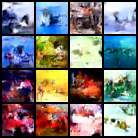
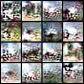

# Assignment 4 · CIFAR-10 image generation

Each grid shows 16 generated 32 × 32 RGB images returned by the FastAPI
endpoint using seed 42.

| Diffusion | Energy-based model |
| --- | --- |
|  |  |

[Run the API and reproduce training](../README.md#assignment-4--cifar-10-image-generators) ·
[Theory answers](theory_answers.md)
